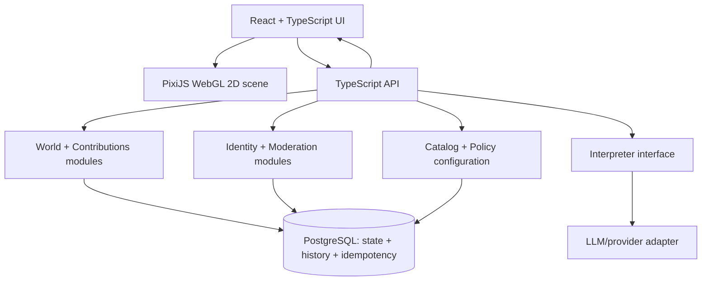

# Shared World — Architecture & Engineering Principles v0.1


Public project-content export. Source wording and proposed/open status are retained. Personal attribution and internal source links are removed. The architecture companion was subsequently approved; its explicitly open decisions remain open.


The POC specification defines what we are testing. This companion defines how we build it safely and coherently. The architecture below is PROPOSED, not confirmed.

## 1. Purpose and scope

Prove one public shared illustrated world: explore without login → write a short sentence → privately preview → explicitly publish with identity → share → someone continues → return to real attributed changes. English documentation and UI; supported input languages remain open.

Use a bounded asset/relationship catalog, one primary change per contribution, persistent state and basic moderation. The provisional policy is additive only: no destructive replacement, deletion or interior placement. Unsupported intent is explained, never silently approximated.

Engineering standards: domain boundaries, API/provider independence, restrained DRY/reuse, no hard-coded product data, accessibility and security. Shared World adds concrete preview, revision and attribution contracts. Privacy and baseline security apply from the start.

Defer microservices, general event-driven infrastructure, universal simulation, elaborate animations, real payments, commerce, clubs, capsules and 3D. The existing POC specification is unchanged; this draft records later refinements for joint review.

## 2. Engineering principles

### Modular boundaries / DDD-lite

Rule — One app with explicit World, Contributions, Catalog, Identity and Moderation modules; no microservices.

Why — Keep domain rules understandable without distributed-system overhead.

Verify — Review dependency direction; UI and provider SDKs cannot own domain rules. Test modules through their public contracts.

### Objects hold state; surfaces display

Rule — Persist object and domain state; map, panels and history render that state, not competing copies.

Why — Keep all views consistent.

Verify — Refresh and alternate-view tests show the same IDs, authors and revision; scene nodes never become the source of truth.

### Preview is not publication

Rule — A proposal is private, editable and reversible; only explicit publish creates a public application.

Why — Protect intent and prevent accidental writes.

Verify — Two-session test proves previews never alter the shared world; edit/discard leave no application.

### Server is authority

Rule — Validate typed actions, asset IDs, placement, relationships, policies and permissions on every publish.

Why — Neither clients nor model output are trusted.

Verify — Tampered requests fail server tests; unsupported ideas explain limits rather than silently substitute.

### Attributed, append-only history

Rule — Commit narrow domain records with author, origin, parent contribution and change; corrections append records. No event bus or full event-sourced platform.

Why — Preserve continuity and accountability.

Verify — Review prohibits overwriting attribution; hide/unhide adds moderation records and public reads filter hidden content.

### Exactly-once publication effect

Rule — Use an actor-scoped idempotency key, payload fingerprint, unique constraint and one transaction for application, revision and history. Check the proposal base revision.

Why — Retries cannot duplicate changes; stale previews cannot overwrite the world.

Verify — Concurrent retry tests return the same result; key reuse with different input fails; revision conflict requires re-preview and explicit confirmation. No claim of exactly-once network delivery.

### Recoverable failures; honest states

Rule — Preserve drafts across errors and distinguish interpreting, preview-ready, publishing, published, conflict, unavailable and failed.

Why — People can recover without losing work or believing a failed write succeeded.

Verify — Timeout/reload tests recover by idempotency key; unavailable moderated targets show an honest message. Never fabricate activity.

### Only functional controls

Rule — Show only working actions; no decorative controls implying unavailable features.

Why — A POC must be truthful and understandable.

Verify — Every visible action has an acceptance test; temporary disabled states have a reason and recovery path.

### Provider-agnostic integration

Rule — Put the interpreter/LLM behind an interface returning a versioned typed structured action, never executable code. Server validates it independently.

Why — Allow provider changes without rewriting the domain.

Verify — Use deterministic adapter fixtures; test negation, relationships, unsupported requests and invalid output. Provider-specific types stay in adapters.

### DRY with restraint

Rule — Use semantic names and shared catalog/action types; abstract on a second real use, not anticipated reuse.

Why — Avoid both divergent rules and premature frameworks.

Verify — Review duplicated business rules and vague names; schema/contract tests keep UI and API aligned.

### No hard-coded values

Rule — Catalog, UI copy, limits, weather/animation rules and moderation policies belong in typed configuration or the database, not scattered literals.

Why — Product tuning must not require hunting through components and handlers.

Verify — Lint magic numbers and restricted literals outside approved config/copy modules; review each exception. Test a config change end-to-end; server remains authoritative.

### Security by default

Rule — Validate on the server; rate-limit interpretation and publication; moderate; keep secrets server-side; authorize separately from authorship.

Why — Attribution is not permission to modify, publish or moderate.

Verify — Negative authZ tests, abuse-limit tests and secret scanning are gates; users cannot impersonate authors or grant themselves moderator capabilities.

### Accessibility from the start

Rule — Target WCAG 2.2 AA for the shipped POC surfaces, with a focused audit rather than an unsupported conformance claim: keyboard, names, focus, contrast, non-color cues, scene text alternative and reduced motion.

Why — The core journey must work beyond pointer-only visual interaction.

Verify — Manual keyboard and screen-reader journey plus automated checks; verify focus after preview/conflict and a no-motion path.

### Privacy in analytics

Rule — Never include prompt text or PII in analytics events or URLs. Use opaque object/contribution IDs and minimal event properties.

Why — A public world is not permission to export private drafts or identity data.

Verify — Review analytics allowlists; assert event payloads and share URLs contain no text/PII. Decide retention before testing.

### Requirement-based tests

Rule — Trace tests to journey requirements and risks; no borrowed coverage percentage.

Why — Prove the product contract rather than optimize a vanity metric.

Verify — Gate release on preview isolation, persistence, retries, conflicts, continuation, attribution, moderation, contextual links and real return updates in two sessions.

## 3. Configuration, not magic values

| Concern | Single source / concrete example |
| --- | --- |
| Prompt limit | `limits.promptMaxCharacters`: latest proposal 250; UI counter and API validation consume the same policy. |
| Catalog | `CatalogAsset` records hold IDs, allowed relationships, placement footprint and licensed visual references; no asset-ID switches in components. |
| Copy | English copy keys such as `publish.conflict` live in a copy module, not JSX or API business rules. |
| Visual rules | Per-asset reaction config defines light schedules, wind response and smoke intensity; no scattered weather conditionals. |
| Moderation | Versioned policy config controls allowed actions and rate limits; persisted moderation state records actual decisions. |

The earlier POC Page proposes 240 characters; later discussion proposes approximately 250. Neither is a finalized constant: choose one configurable policy before implementation and synchronize the spec only after approval. Define Unicode counting semantics so client and server agree.

No hard-coded values means no scattered changeable product data—not zero literals. Typed enum members, mathematical constants and explicit test fixtures are legitimate. Centralized, named defaults are allowed; every configurable value needs an owner, schema, validation and safe fallback. Version the catalog/policy used by a proposal and revalidate at publication.

Review gate: flag user-facing inline strings, magic numbers, embedded catalog IDs and policy conditionals outside approved modules. A reviewer documents justified exceptions; lint alone cannot establish correctness. Demonstrate changing a prompt limit or asset reaction without editing rendering or publishing logic.

## 4. Proposed architecture — NOT CONFIRMED

React + TypeScript for accessible UI; PixiJS/WebGL for a 2D isometric scene; a TypeScript API for interpretation and domain commands; PostgreSQL for durable state and transactional publication. One modular application, not a microservice topology. Polling or incremental updates remain options; no instant-sync promise.

Mermaid component diagram source (portable design artifact):



Mermaid sequence diagram source. The preview response does not write public world state; identity is required at publication. A returned share link is created only for a committed application.

```mermaid
sequenceDiagram
  actor A as Contributor A
  participant UI as Browser
  participant API as TypeScript API
  participant I as Interpreter adapter
  participant DB as PostgreSQL
  actor B as Contributor B
  A->>UI: Write sentence in context
  UI->>API: Interpret(text, context, baseRevision)
  API->>I: Request typed action
  I-->>API: Structured proposal
  API->>API: Validate schema, catalog and policy
  API-->>UI: Private proposal + explanation + baseRevision
  UI-->>A: Reversible preview; no public write
  A->>UI: Establish identity; explicitly confirm publish
  UI->>API: Publish(proposalId, baseRevision, idempotencyKey)
  API->>API: Authenticate, authorize, moderate, revalidate
  API->>DB: Look up actor/key and request fingerprint
  alt Already committed same request
    DB-->>API: Return prior application
  else New request
    API->>DB: Transaction: conditional revision check
    alt Revision stale or target unavailable
      DB-->>API: Conflict; no application
      API-->>UI: Keep draft; re-preview and reconfirm
    else Revision valid
      API->>DB: Apply + append attributed history + key result + revision
      DB-->>API: Commit application and contribution IDs
    end
  end
  API-->>UI: Publication result or recoverable state
  UI-->>A: On success: history + contextual share link
  A-->>B: Share contextual link
  B->>UI: Open contribution; write continuation
  Note over UI,DB: Repeat interpret, private preview and publish; link parent contribution

```

Implementation contract: process retries against the idempotency record before rejecting an already-successful request as stale. Atomically commit world changes, contribution history and the stored result. A lost response is recoverable by the same key; any fresh proposal gets a new explicit confirmation.

## 5. Domain model sketch

| Concept | Responsibility |
| --- | --- |
| World | Stable ID, current revision and initial public root space; only one public world in this POC. |
| Space | Stable ID and placement bounds; optional future container-object pointer keeps interiors possible without implementing them. |
| PlacedObject | Stable object ID, space ID, catalog asset/version, position, supported state and originating application. |
| CatalogAsset | Versioned asset definition, footprint, supported actions/relationships and visual reaction config. |
| Relationship | Typed supported link between stable objects or contributions; validate endpoints and semantics. |
| Contribution | Attributed published intent, author ID, parent/origin, approved text and application ID; continuation preserves its predecessors. |
| Proposal | Private interpreted action, draft context, base revision and catalog/policy versions; editable/discardable, not a public mutation. |
| Application | Committed execution of a validated proposal, resulting revision and idempotency result; distinct from proposing. |
| Author | Persistent pseudonymous identity; authorship records provenance, not authorization. |
| ModerationState | Visibility/availability and reason with appended decisions; hiding does not erase attribution/history or expose hidden content. |
| WorldState | Persisted global day/night and weather settings or schedule; clients derive visuals, not individual frame state. |

Keep current state plus an append-only attributed history in the same database. This is not a requirement to reconstruct the entire world by replaying events. Draft storage, retention and private proposal access still need explicit decisions.

## 6. Visual life

Persist structures and meaningful shared world state; derive animation locally. Do not persist or synchronize per-frame cars, boats, people, bikes, planes, rotors, particles, smoke, wind motion or lamp flicker. These are visual life, not autonomous shared simulation.

Start with global day/night and weather. Each asset declares reactions to light, rain, wind, heat and cold through configuration. Build only a few polished effects; respect reduced motion, avoid flashing and pause animation in background tabs. Resume from world state rather than replaying missed frames.

Scene rendering and DOM interaction stay separate: a keyboard-accessible object list/details view exposes meaningful objects, attribution, context and actions without requiring the illustration.

## 7. Optionality and open decisions

1. Approve or revise the proposed stack after a short performance spike; choose hosting, identity and update transport separately.
2. Performance spike: render representative catalog density plus selected moving entities, weather and lighting on agreed desktop and mobile devices. Measure frame time, memory, initial load and background-tab behavior; agree budgets before evaluation and record a go/no-go for PixiJS.
3. Finalize minimum assets, relationships, placement bounds, one-change action schema and how unsupported intent is explained.
4. Confirm prompt length (240 in the earlier spec versus approximately 250 in later discussion), Unicode counting and supported input languages.
5. Decide revision granularity, proposal lifetime, conflict UX, idempotency retention and recoverable draft storage.
6. Select pseudonymous identity, publishing access, moderation workflow, rate limits, privacy retention and analytics allowlist.
7. Keep interiors open through stable space/container references; top-down may fit later, but first-person interiors require a different 3D pipeline and are not promised.
8. Keep commerce as a separate future domain. No products, inventory, checkout or payments are being built into the POC.
9. Resolve neighbor, consent, protection and replacement rules before any non-additive feature. Stable IDs and history preserve options; they do not settle policy.
10. Before implementation, approve this companion and reconcile later decisions into the POC spec deliberately. No repository changes or build have started through this document.
