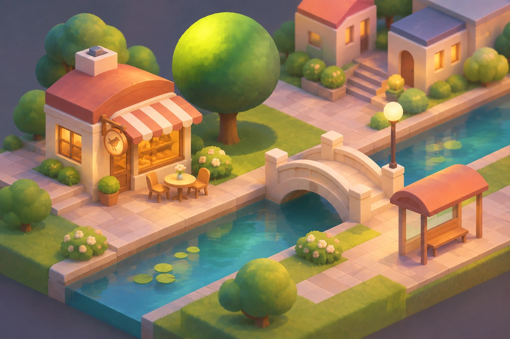

# Shared World — visual direction 3B

**Decision date:** 2026-11-12 (Europe/Berlin)  
**Decision authority:** project owner, explicit selection of **3B** in the second visual comparison round  
**Status:** **approved as an art-direction reference**; **not** approval of the current renderer output, production assets, technical feasibility, or product acceptance.

## Decision and scope

The selected direction is **3B — Soft 3D Isometric Diorama with Painterly Lighting**. It was the second image in the follow-up set after the owner preferred the broader "style 3" family. The image shows a café, a rounded tree with localized lime-green light, a canal, an arched bridge, a bus shelter, nearby buildings, vegetation, and a warm evening-like atmosphere.

The owner selected **the visual language**, not the literal layout, placement, shapes, palette values, or object count depicted here. The existing **prototype 00** continues to govern the world composition and recognizable landmark requirements until explicitly revised. This 3B image is a lighting/material reference, not prototype 06 and not a replacement for historical concept prototypes 00–05.

## Art-direction contract — candidate v1, to be validated

1. **Geometry and camera:** fixed isometric or isometric-like view; restrained, legible sculptural volumes, softened corners, clear silhouettes, consistent depth and object scale.
2. **Materials:** predominantly matte; gentle surface variation or painterly texture; avoid shiny plastic, chrome-like reflections, heavy gloss, and photographic realism.
3. **Lighting:** coherent warm key light from the upper-left; localized luminous areas on curved surfaces, notably a distinct lime-green highlight on the round-tree canopy, fading through midtones toward shaded regions. Avoid relying solely on a uniform end-to-end vector gradient.
4. **Shadows:** soft cast shadows, contact shadows at intersections and ground attachment, restrained ambient occlusion for the sense of a miniature physical environment.
5. **Edges:** clean/readable boundaries with subtle antialiasing; do not indiscriminately blur silhouettes or obscure interaction targets. Soften volume transitions more than the object cutout.
6. **Color:** warm pastel architecture, turquoise water, lively but balanced vegetation and accents. Preserve the recognizable Shared World/prototype-00 scene identity rather than blindly copying this image's colors.
7. **Motion:** restrained and intentional. Static materials and lighting should be baked into reusable textures; do not require costly per-frame illumination to achieve this look.

These are *directional properties*, not yet numeric color, shadow, performance, or material specifications.

## Rendering and implementation boundary

Keep the existing web application and **PixiJS/WebGL** pipeline for the proof of concept. The image is an illustration made for comparing styles; it is **not** a PixiJS screenshot, scene asset, engine benchmark, editable 3D scene, or proof that the effect is technically reproducible. Source objects may use authored SVG with baked gradients/textures or offline-rendered images when justified; any Blender/3D pre-rendering is an optional asset-production technique, not a Unity/Godot migration decision.

Continue to treat the persisted catalog and placement records as authoritative; a visual-style change must not affect publication, placement, authorship, moderation, or privacy rules. Do not replace production objects with crops of this reference image. Existing object provenance and licensing gates still apply.

## First validation gate before catalog-wide rollout

Implement and review **only three representative assets** in an isolated visual trial:

- **Round tree:** sphere volume, localized upper-left lime highlight, irregular soft tonal falloff, contact/cast shadow, legibility at reduced size.
- **Bird café:** connected planes, readable roof/awning, matte materials, warm face lighting, shadow/occlusion at overlaps, identifiable form compared with prototype 00.
- **Bridge:** volume and thickness, readable isometric projection, soft but intentional side/top-face lighting, shadow placement over the canal.

Produce side-by-side evidence for (a) prototype 00 and the current build, and (b) current build and candidate 3B treatments, using **the same camera, crop, scale, and viewport** for each before/after pair. Evaluate the three assets **in context**, not just as isolated images. Include desktop and narrow/mobile layout inspection, WebGL fallback, reduced motion, memory/texture budget, and measured frame time. Record what was actually measured; emulation alone is not a real-device pass. Run existing automated tests and review visual fidelity manually; do not treat a color-difference or landmark overlap score as artistic acceptance.

**Gate outcome:** the owner reviews the three-asset evidence and explicitly accepts, requests adjustments, or rejects the style implementation. Do not redraw the rest of the catalog on assumption.

## Reference asset and provenance

- **Path:** `docs/visual/style-3b-approved.webp`
- **Content:** the user-approved 3B image generated in this conversation, preserved as a visually faithful, high-quality WebP export (1536 × 1024) from the approved PNG; no artistic alterations or metadata were added during export.
- **Original PNG SHA-256:** `29f7f1afc41b8d8e205047265e8dc38c409c0e7731969e1c5c72c0a743501526`
- **Committed WebP SHA-256:** `3506e0234bdbcf5f73c19c829ddc0270721b3614dfa59499536ebdfabeca97c7`
- **WebP size:** 193,666 bytes. Original image dimensions retained. Recompression is lossy (quality 94); this is a distribution reference rather than an archival byte-identical PNG.
- **Provenance:** AI-generated design study explicitly selected by the owner on 2026-11-12. It does not imply any trademark, character, or third-party art license.
- **Historical prototypes:** `docs/prototypes/manifest.json` remains unchanged and continues to describe exactly six prior reference images (00–05).

## Non-approvals

This decision does **not** authorize paid calls, purchasing external credits, new service accounts, hosting, deployment, image generation for the runtime, a renderer/engine migration, an automatic merge, or release/product acceptance. Such actions remain subject to their separate owner approvals and the existing project gates.
